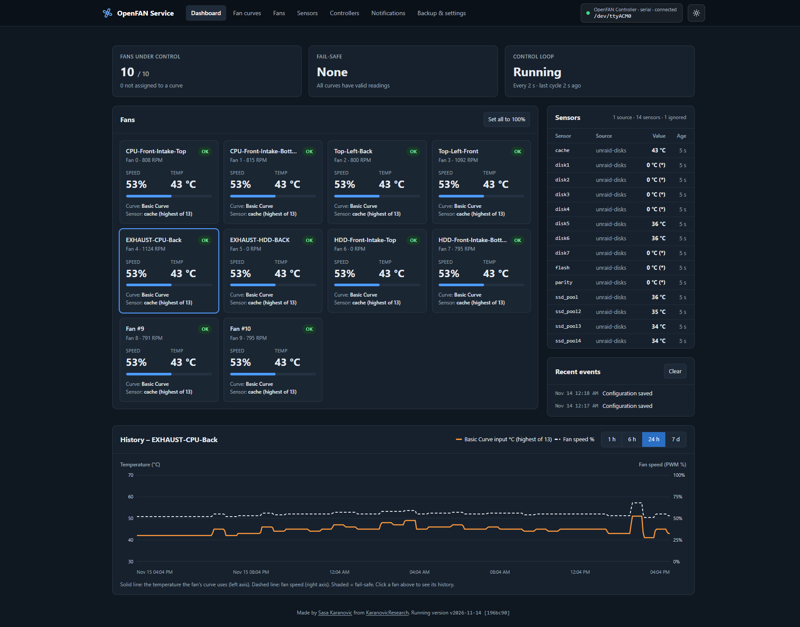
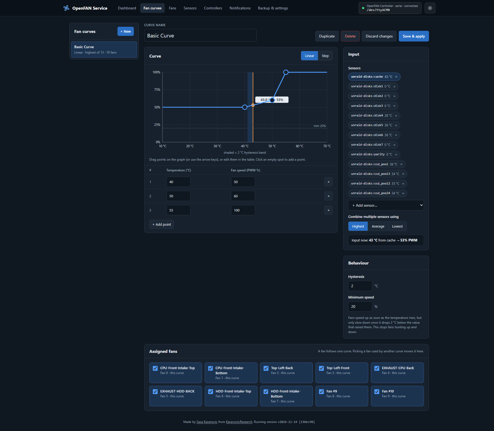

# OpenFAN Service






Automatic, temperature-driven fan control for the [OpenFAN Controller](https://github.com/SasaKaranovic/OpenFanController), with a web UI.

* Draw **fan curves** in the browser and assign them to one or more fans.
* Feed temperatures from **plugins**: Unraid disks, Linux hwmon (CPU, NVMe, motherboard), any command or script, a file, a JSON URL, or values your own script **pushes** to the API. The rest of the app does not care where a temperature comes from, so it runs the same on Unraid, TrueNAS, Proxmox or plain Linux.
* **Fail-safe by design**: if a curve is deleted, a sensor disappears, goes stale or fails, its fans go to **100%** until the problem is gone. You get a warning in the UI and, if you want, a **notification** (Telegram, Discord, ntfy, e-mail, Pushover, Gotify, Slack and 100+ more).
* **History graphs** of temperature and fan speed, per fan.
* **Backup and restore** of the whole configuration, plus automatic backups on every change.
* One Docker container, one web port (**5340**), one config folder.

---

## Quick start

1. Plug the OpenFAN controller into the server over USB and find its device (usually `/dev/ttyACM0`):
   ```sh
   ls -l /dev/serial/by-id/ /dev/ttyACM*
   ```
2. Save [`docker-compose.yml`](docker-compose.yml) and adjust the `devices:` line if needed.
3. Start it:
   ```sh
   docker compose up -d
   ```
4. Open `http://<server>:5340`. The controller is detected automatically.
5. In the web UI:
   1. **Sensors** → *Add sensor source* (for example *Unraid disks* or *Linux hwmon*) → *Test* → *Add source*.
   2. **Fan curves** → *+ New*: pick the sensors, shape the curve and tick the fans that should follow it → *Create curve*.

That's it. Fans that are not assigned to a curve are **not managed**: the service never touches them.

> Want to look around first? `docker compose -f examples/docker-compose.demo.yml up` starts the service with a simulated controller and sensors.

### Unraid

Install the container with the template in [`examples/unraid-template.xml`](examples/unraid-template.xml), or by hand with the settings in [`examples/docker-compose.unraid.yml`](examples/docker-compose.unraid.yml):

| What | Container | Host |
|---|---|---|
| Config (settings, backups, history) | `/config` | `/mnt/user/appdata/openfan-service` |
| Unraid disk info, **read-only** | `/unraid` | `/var/local/emhttp` |
| OpenFAN USB device | `/dev/ttyACM0` | `/dev/ttyACM0` |
| Web UI port | `5340` | `5340` |

Then add a sensor source of type **Unraid disks** with path `/unraid/disks.ini`. Spun-down disks are reported by Unraid as `*`. You choose what that means per source: **0 °C** (default), **ignore** (leave out of the curve), or **fault** (fail-safe).

### TrueNAS SCALE

See [`examples/docker-compose.truenas.yml`](examples/docker-compose.truenas.yml). Store `/config` on a dataset, set `PUID`/`PGID` to `568`, and use the **Linux hwmon** sensor source. hwmon covers CPU, NVMe and SATA drives that have the `drivetemp` driver.

### Bare-metal Linux / Proxmox / anything else

Use the main [`docker-compose.yml`](docker-compose.yml). Good sensor sources are **Linux hwmon**, a **Command** (for example `nvidia-smi --query-gpu=temperature.gpu --format=csv,noheader`), or the **Push API** from a cron job or script.

### Using the REST API instead of USB

If the controller is connected to another machine, or you want to keep running the OpenFAN Controller app, add a controller of type **OpenFAN over network (REST API)** with the app's address, for example `http://192.168.1.10:3000`. See [`examples/docker-compose.rest.yml`](examples/docker-compose.rest.yml).

With a REST controller, the **Fans** page has an *Import fan names from controller* button. It copies the fan names you set in the OpenFAN Controller app. Over USB the board stores no names, so the button is not shown.

> A USB serial port can only be used by one program at a time. When this service talks to the controller over USB, the OpenFAN web app cannot connect to it at the same time.

---

## How the fail-safe works

Every control cycle (default every 2 s), each fan gets one of these states:

| State | When | Fan speed |
|---|---|---|
| **OK** | Curve and all its sensors are fine | From the curve |
| **FAIL-SAFE** | Curve deleted · curve has no sensors · a sensor is missing, failing, or has no valid reading for 60 s (configurable) | **100%** (configurable, 50–100) |
| **STARTING** | Service just started, sensors have not reported yet | 100% |
| **OVERRIDE** | You pressed *Set all to 100%* | 100% for 10 minutes |
| **OFFLINE** | The controller is not connected | Unchanged (cannot be set) |
| **NOT MANAGED** | Fan has no curve | Not touched |

* Fans **return to their curve automatically** when the problem is fixed. A notification is sent both ways.
* If **any** sensor of a multi-sensor curve fails, its fans go to fail-safe, because the missing sensor could be the hot one.
* A sensor that reports an error keeps its last good value until the stale timeout runs out. Short glitches, such as a file being rewritten while it is read, therefore do not cause alarms.
* If the controller is unreachable for longer than the stale timeout, you get one alert, and another one when it reconnects.
* When the container stops, every managed fan is set to **100%** (configurable), so a stopped service never leaves fans slow.
* A watchdog restarts the process if the control loop ever stops cycling. With `restart: unless-stopped`, Docker then starts it again.
* A broken `config.yaml` never stops the service: it runs from the newest valid backup and shows a warning.

> **Hardware note:** if the whole server or Docker hangs, no software can change the fans. They stay at their last speed. If you want protection against that too, a firmware watchdog on the controller would be the next step.

### Hysteresis

Each curve has a hysteresis setting (default 2 °C). Fans speed up as soon as the temperature rises, but only slow down once it has dropped by the hysteresis below the value that raised them. This stops fans from hunting up and down around a curve point.

---

## Sensor sources (plugins)

| Type | Reads | Typical use |
|---|---|---|
| Unraid disks | `disks.ini` from `/var/local/emhttp` | Unraid array, pool and cache disks |
| Linux hwmon | `/sys/class/hwmon` | CPU (k10temp, coretemp), NVMe, board sensors, drivetemp |
| Command / script | Output of a shell command | smartctl, nvidia-smi, ipmitool, your own script |
| File | A file another program writes | Anything that can write a number or JSON |
| HTTP / JSON | A URL returning JSON | Home Assistant, Glances, Netdata, your API |
| Push (API) | Values POSTed to the service | Cron jobs, scripts on other machines |
| Demo | Simulated values | Trying things out |

Any sensor can be **ignored** on the Sensors page, for example an empty Unraid slot that always reports `DISK_NP_DSBL`. An ignored sensor is hidden from the dashboard, never reports problems, and is left out of any curve that uses it. If *all* sensors of a curve are ignored, its fans go to fail-safe. *Restore* brings an ignored sensor back.

The command, file and push types accept a single number, `name=value` lines, or JSON. Use *Multiply by* `0.001` for millidegree values.

### Push API

Create a source of type **Push** (for example with id `script`), then send values:

```sh
curl -X POST http://server:5340/api/push/script \
  -H 'Content-Type: application/json' \
  -H 'X-OpenFAN-Token: <token, if you set one>' \
  -d '{"cpu": 52.5, "gpu": 61}'
```

Sensors appear as `script:cpu` and `script:gpu`. If values stop arriving, they go stale after the stale timeout and their fans go to fail-safe.

### Writing your own plugin

Put a `.py` file in `/config/plugins/` and restart the container. Copy [`examples/plugins/example_random.py`](examples/plugins/example_random.py) to start:

```python
from openfan_service.sensors import Option, Reading, SensorPlugin

class MySensor(SensorPlugin):
    type_name = "my_sensor"          # unique
    title = "My sensor"
    options = [Option("path", "Path", default="/data/temp.txt")]

    def read(self):                  # called in a worker thread every poll interval
        value = float(open(self.opts["path"]).read())
        return {"temp": Reading(value)}
```

The options you declare become a form in the web UI. Raise an exception if the source failed.

---

## Notifications

**Notifications** page → paste one or more [Apprise URLs](https://github.com/caronc/apprise/wiki) → *Send test message* → *Save*. Examples:

| Service | URL |
|---|---|
| Telegram | `tgram://<bot token>/<chat id>` |
| Discord | `discord://<webhook id>/<webhook token>` |
| ntfy | `ntfys://ntfy.sh/<topic>` |
| Pushover | `pover://<user key>@<app token>` |
| E-mail | `mailtos://<user>:<app password>@gmail.com` |

WhatsApp works through Apprise's `whatsapp://` URL, which needs a Meta WhatsApp Business account.

---

## Configuration, backups and permissions

Everything lives in the `/config` volume. Mount it to a folder on disk so it survives container re-creation and updates:

```
/config/config.yaml        all settings (YAML; editable by hand, validated on load)
/config/backups/           automatic backup on every change (last 30 kept)
/config/history.sqlite     temperature / fan history (7 days by default)
/config/plugins/           your own sensor plugins
```

* **Backup & settings** → *Download configuration* saves one YAML file. *Restore from file…* loads it back, and the current config is backed up first.
* Every save is atomic (temp file + rename) and validated. An invalid change is rejected and never applied.
* The container runs as `PUID`:`PGID` (default `99:100`, Unraid's nobody:users). It fixes the ownership of its own files in `/config` on start. Set them to your user (`id -u`, `id -g`) on other systems, or to `568` on TrueNAS.
* On network shares (SMB/NFS), the history database automatically uses a safer journal mode.

### Environment variables

| Variable | Default | Meaning |
|---|---|---|
| `PUID` / `PGID` | `99` / `100` | Owner of files in `/config` |
| `UMASK` | `022` | File creation mask |
| `TZ` | `UTC` | Time zone for logs |
| `OPENFAN_PORT` | `5340` | Web UI / API port |
| `OPENFAN_PASSWORD` | – | Turn on the login with this password (overrides the UI setting) |
| `OPENFAN_SERIAL_PORT` | `auto` | First start only: serial port of the controller |
| `OPENFAN_CONTROLLER_URL` | – | First start only: use the REST API at this URL instead of USB |
| `OPENFAN_DEMO` | `0` | First start only: simulated controller and sensors |
| `OPENFAN_LOG_LEVEL` | `info` | `debug`, `info`, `warning` |
| `OPENFAN_USER_PLUGINS` | `1` | Load plugins from `/config/plugins` |

### Login

Off by default, because the service is meant for a home network behind a firewall. Turn it on under **Backup & settings → Login**, or with `OPENFAN_PASSWORD`. Health checks (`/api/health`) and push requests (which use their own per-source token) do not need the login.

---

## Versions

There are no semantic version numbers. Every Docker image build is a new version, named by its **build date (UTC)** and the **git commit**. The page footer, `/api/health` and the log show it as `v2026-11-13 [a1b2c3d]`.

| Where | Version |
|---|---|
| Published image (GitHub workflow) | Tags `:latest`, `:2026-11-13` and `:2026-11-13-a1b2c3d` on every push to `master` (or `release`). One image covers amd64 and arm64; Docker picks the right one. |
| Local build with `scripts/docker-build.*` | Tags `openfan-service:dev` and `openfan-service:2026-11-13-a1b2c3d`. `-dirty` is added when tracked files have uncommitted changes. |
| Plain `docker build` without build arguments | `vdev [unknown]` |
| Running from source | Date and hash of the last commit, plus `-dirty` if there are uncommitted changes |

To pin a specific version, use its date tag instead of `latest`, e.g. `ghcr.io/sasakaranovic/openfan-service:2026-11-13`.

## API

The web UI uses a JSON API that you can script too. Main endpoints:

| Method & path | Purpose |
|---|---|
| `GET /api/health` | Liveness (used by the Docker healthcheck) |
| `GET /api/state` | Live state: fans, sensors, controllers, events |
| `GET /api/config` | Current configuration (secrets masked) |
| `POST /api/curves`, `PUT/DELETE /api/curves/{id}` | Manage curves (body may include `fans: ["main:0", ...]`) |
| `PUT /api/fans/{controller}/{index}` | `{ "name": "...", "curve": "id" \| null }` |
| `POST /api/sources`, `PUT/DELETE /api/sources/{id}`, `POST /api/sources/test` | Sensor sources |
| `POST /api/sensors/ignore` `{ref, ignored}` | Ignore or restore one sensor |
| `POST /api/push/{source}` | Push sensor values |
| `POST /api/controllers`, `PUT/DELETE /api/controllers/{id}`, `POST /api/controllers/test` | Controllers |
| `GET /api/controllers/{id}/fan-names`, `POST /api/controllers/{id}/fan-names/import` | Read / import the fan names saved in the OpenFAN Controller app (REST controllers only) |
| `GET /api/history?fan=main:0&hours=24` | History for one fan (`temp`, `pwm`, `rpm`, `fs`) |
| `POST /api/override` `{pwm, minutes}`, `DELETE /api/override` | Manual override |
| `DELETE /api/events` | Clear the *Recent events* list |
| `GET /api/backup`, `POST /api/restore`, `GET /api/backups` | Backup and restore |

---

## Development

See **[docs/DEVELOPMENT.md](docs/DEVELOPMENT.md)** for running from source on Windows and Linux, building and running the Docker image locally, USB passthrough on Windows, and tools that fake the hardware.

```sh
pip install -r requirements-dev.txt
OPENFAN_DEMO=1 OPENFAN_CONFIG_DIR=./config python -m openfan_service   # http://localhost:5340
python -m pytest
```

The web UI is plain HTML, CSS and JavaScript modules in `openfan_service/web/`, with no build step. Edit and reload.

```
openfan_service/
  app.py              wiring, auth middleware, watchdog
  engine.py           control loop + fail-safe state machine
  curves.py           curve maths (pure functions)
  models.py           config schema (pydantic)
  config_store.py     atomic save, backups, recovery
  sensors/            plugin interface, built-in plugins, polling manager
  controllers/        OpenFAN serial + REST drivers, connection manager
  history.py          SQLite history
  notifier.py         Apprise notifications
  api.py              HTTP API
  web/                the web UI
```

---

#### Sasa Karanovic

<a href="https://sasakaranovic.com/" target="_blank" title="Sasa Karanovic Home Page"> Home Page</a> &nbsp;&middot;&nbsp;
<a href="https://youtube.com/c/sasakaranovic" target="_blank" title="Sasa Karanovic on YouTube"> YouTube</a> &nbsp;&middot;&nbsp;
<a href="https://github.com/sasakaranovic" target="_blank" title="Sasa Karanovic on GitHub"> GitHub</a> &nbsp;&middot;&nbsp;
<a href="https://twitter.com/_sasakaranovic_" target="_blank" title="Sasa Karanovic on Twitter"> Twitter</a> &nbsp;&middot;&nbsp;
<a href="https://instagram.com/_sasakaranovic_" target="_blank" title="Sasa Karanovic on Instagram"> Instagram</a> &nbsp;&middot;&nbsp;
<a href="https://github.com/sponsors/SasaKaranovic" target="_blank" title="Sponsor on GitHub"> Sponsor on GitHub</a>
